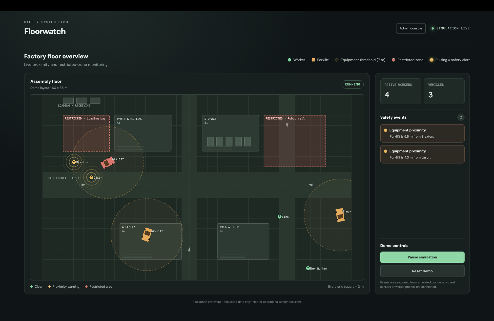

# Floorwatch

**Feel the danger before you see it.**

A forklift comes around a corner. The worker cannot hear it, because the warehouse is too loud. The worker does not look at a screen, because the worker is at work. The driver cannot see the worker behind the shelf.

Floorwatch makes the phone in the worker's pocket vibrate. At the same time, the phone of the driver vibrates. Both people stop before an accident occurs.

## No app. No screen. Only a signal.

Workers and drivers do not open an app. They do not look at a screen. They do not touch the phone. The phone stays in the pocket and sends a vibration when there is danger.

Each person already has a device. Floorwatch uses that device as a sensor and as an alarm.

We made Floorwatch for the **"No App"** track: interfaces for people who will never open an app, such as warehouse workers and drivers.

## How it works

1. Each worker and each vehicle has a device. In this demo, the device is a phone. On a real site, it can also be a tag, a badge, or a watch.
2. The system finds the position of each device on the floor.
3. Safety rules compare the positions many times each second.
4. When a vehicle comes near a worker, the system sends a signal to the two devices.
5. Only the people in danger feel the vibration. All other people continue their work.

## The vibration language

Each danger has a different pattern. A worker can identify the danger without a look at the phone.

| Danger | Who feels it | Pattern |
|---|---|---|
| A vehicle is less than 7 m from a worker | the worker and the driver | 1 long buzz |
| A vehicle is less than 3.5 m from a worker | the worker and the driver | 3 long buzzes, again every 1.5 s until the danger stops |
| A worker goes into a restricted zone | the worker | 2 sharp taps and 1 buzz, again every 2 s until the worker goes out |
| The danger stops | each person who felt an alert | 1 light tap |

If there are two dangers at the same time, the phone gives the pattern of the worse danger.

## About the dashboard and the admin console

**The dashboard and the admin console are not the product.** We made them only for this demo.

- **The simulator** moves workers and vehicles on a test floor. It replaces real position data, because we do not have indoor position hardware at the hackathon.
- **The admin console** registers the people, the vehicles, and the restricted zones of a site. A safety manager does this one time.
- **The dashboard** (the screenshot above) shows the floor from above. It lets you see what the phones feel. A pulse around a worker on the map is a vibration in a real pocket.

On a real site, nobody must watch this map. The devices do the work.

## What is real and what is simulated

| Real | Simulated |
|---|---|
| Vibration on real iPhones | The positions of people and vehicles |
| The safety rules | The movement of people and vehicles |
| The live link from the rules to each phone, in less than a second | |

## Next steps

- Get indoor positions from UWB or BLE tags, with an accuracy of less than 1 m.
- Send the signal to watches, badges, and safety vests.
- Make the phone vibrate when it is locked. This needs a native app.
- Show the direction of the danger, for example "vehicle behind you".

## Run it

- To start the dashboard, the relay, and the phone app, read [Run the demo](TECHNICAL.md#run-the-demo).
- To do the demo with three phones, read [Demo with phones: checklist](TECHNICAL.md#demo-with-phones-checklist).
- The architecture and the data formats are also in [TECHNICAL.md](TECHNICAL.md).

> Floorwatch is a hackathon prototype. Do not use it for real safety decisions.
